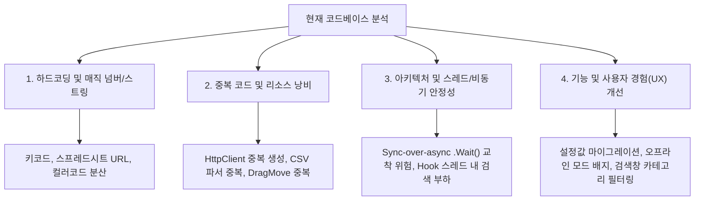
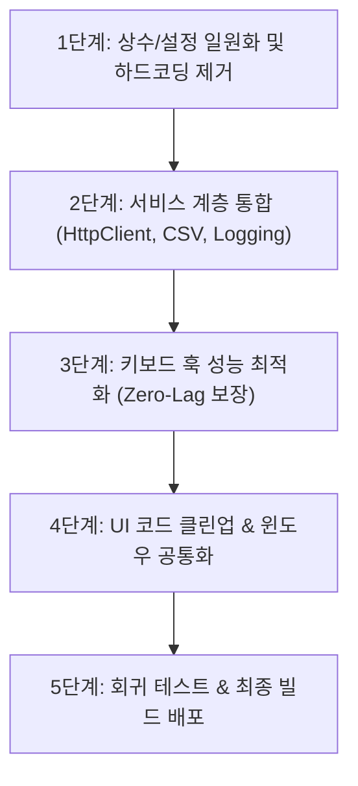

# ChatHelper 코드베이스 종합 리팩토링 및 기능 개선 계획서

본 문서는 **ChatHelper (CS 실시간 채팅 도우미 & AI 어시스턴트)** 프로젝트의 유지보수성, 성능, 코드 품질 및 프로젝트 본래 취지와의 정합성을 높이기 위한 종합적인 점검 결과 및 단계별 리팩토링 계획서입니다.

다른 컴퓨터에서 작업을 이어갈 때도 아래 가이드에 따라 즉시 개발 환경을 구성하고 리팩토링 작업을 연속해서 진행할 수 있습니다.

---

## 0. 다른 컴퓨터에서 바로 이어 작업하기 (Quick Setup Guide)

새로운 PC나 다른 환경에서 작업을 이어갈 때는 아래 4단계를 진행하면 즉시 동일한 개발/실행 환경이 세팅됩니다.

### 1) 최신 코드 가져오기 (Git)
```bash
git checkout csharp
git pull origin csharp
```

### 2) Ollama 및 로컬 AI 모델 확인 (필요시)
- [Ollama 공식 사이트](https://ollama.com/) 설치 후 실행
- 터미널에서 초경량 모델 확인 및 다운로드:
```bash
ollama list
# qwen2.5:1.5b 모델이 없다면 아래 명령어 실행:
ollama pull qwen2.5:1.5b
```

### 3) 환경변수 설정 (.env)
루트 경로에 `.env` 파일이 있는지 확인하고, 필요 시 설정:
```ini
GOOGLE_SHEET_URL=https://docs.google.com/spreadsheets/d/e/2PACX-1vS6hPU3bOau9Gqe1yKye_lo76sZF2A9VrAni1ABzLI5SnMxrjYwVnUecgbSt_iNfGf8IvZ_O0dzxvk6/pub?gid=1212205674&single=true&output=csv
LOCAL_LLM_ENDPOINT=http://localhost:11434
LOCAL_LLM_MODEL=qwen2.5:1.5b
```

### 4) 빌드 및 실행
```powershell
# 개발 빌드
dotnet build ChatHelper\ChatHelper.csproj -c Release

# 단일 실행 파일 배포
dotnet publish ChatHelper\ChatHelper.csproj -c Release -o publish

# 실행
Start-Process publish\ChatHelper.exe
```

---

## 1. 프로젝트 핵심 취지 및 현황 진단

### 1.1 프로젝트 본래 취지 (Core Mission)
1. **Zero-Lag & 무소음**: 고객 응대 중 상담원의 타이핑에 0.001초의 렉이나 방해도 없어야 함.
2. **어디서든 즉시 동작 (Anywhere, Anytime)**: 구글 채팅(Chrome), 카카오톡, 메모장, 사내 웹/앱 등 어떤 환경에서도 단축어 알약 및 단축키(Alt+Q, Alt+X)가 100% 신뢰성 있게 동작해야 함.
3. **최신 정보의 자동 동기화**: 관리자가 구글 스프레드시트에서 수정한 단축어/용어집을 무점검 백그라운드로 자동 반영.
4. **로컬 AI의 매끄러운 지원**: 사내 규정 및 용어집을 준수한 100% 로컬 AI(Qwen 2.5 1.5B) 답변 추천과 자동 시트 등록.

### 1.2 종합 진단 요약



---

## 2. 세부 문제점 분석 (Deep Dive)

### 🚨 영역 1: 하드코딩 및 매직 넘버/스트링 제거
1. **키보드 가상 키코드 (Virtual Key Codes) 하드코딩**:
   - `KeyboardHookService.cs` 및 `MainWindow.xaml.cs`에 `0x51`(Q), `0x58`(X), `0x10`(스캔코드 Q), `0x2D`(스캔코드 X), `0xA4`(VK_LMENU), `0xA5`(VK_RMENU), `0x15`(VK_HANGUL), `0xDC`(VK_OEM_5), `0xE5`(VK_PROCESSKEY) 등의 16진수 숫자가 직접 사용됨.
   - **개선안**: `Win32Api.cs`에 의미가 명확한 상수 및 `VirtualKeyCode` 열거형으로 집중 선언.
2. **구글 스프레드시트 URL 및 GID 하드코딩**:
   - `TemplateManager.DefaultTemplateSheetUrl`, `GlossaryService.DefaultGlossarySheetUrl`에 전체 퍼블리시 URL이 하드코딩되어 있음.
   - **개선안**: 기본 Spreadsheet ID 및 GID를 `AppConstants`로 정의하고, `.env` 또는 `config.json`의 환경변수(`GOOGLE_SHEET_ID`, `GLOSSARY_GID`)와 유연하게 결합하도록 템플릿화.
3. **UI 컬러 코드 (Hex Color) 하드코딩**:
   - `MainWindow.xaml.cs`, `SuggestionBar.xaml.cs`, `QuickAiWindow.xaml.cs` 등 코드 비하인드에서 `"#006000"`, `"#1D4ED8"`, `"#FFFFE1"`, `"#000080"`, `"#6366F1"` 등이 `ColorConverter.ConvertFromString`으로 반복 생성됨.
   - **개선안**: `ThemeManager` 또는 `App.xaml` 리소스 사전(`ThemeColors.xaml`)에 명명된 브러시로 등록하여 일원화.

---

### 🚨 영역 2: 중복 코드 및 리소스 낭비 (DRY 원칙 위반)
1. **`HttpClient` 중복 인스턴스화**:
   - `TemplateManager`, `GlossaryService`, `KeywordRegistrationService`, `OllamaService`가 각각 독립된 `new HttpClient()`를 생성하고 있음.
   - 소켓 고갈(Socket Exhaustion) 위험 및 DNS 변경 미반영 문제 발생 가능.
   - **개선안**: `HttpService` 또는 단일 정적 `SharedHttpClient` 인스턴스(또는 `IHttpClientFactory` 패턴)로 통합 관리.
2. **CSV 파싱 및 이스케이프 로직 분산**:
   - `TemplateManager`, `GlossaryService`, `AuthService`가 CSV 파싱, 쉼표/따옴표 이스케이프를 제각각 구현하거나 의존함.
   - **개선안**: 독립적인 `CsvParserHelper` 유틸리티 클래스로 분리하여 공통 처리 및 유닛 테스트 가능하도록 구성.
3. **윈도우 드래그 및 마우스 핸들러 중복**:
   - `MainWindow`, `QuickSearchWindow`, `QuickAiWindow`, `GlossaryWindow`, `ControlPanelWindow`마다 동일한 `TitleBar_MouseLeftButtonDown`(`DragMove()`)이 복사-붙여넣기 됨.
   - **개선안**: 커스텀 윈도우 베이스 클래스(`BeveledWindowBase`) 또는 Attached Property로 캡슐화.

---

### 🚨 영역 3: 프로젝트 취지(Zero-Lag, 안정성) 및 아키텍처 정비
1. **Sync-over-Async (.Wait() / .Result) 제거**:
   - `TemplateManager.cs`의 `LoadTemplates()` 내부에서 `task.Wait(TimeSpan.FromSeconds(6))`를 동기 호출하고 있음.
   - WPF UI 스레드에서 비동기 작업을 동기로 대기하면 심각한 UI 멈춤(Freezing) 또는 데드락(Deadlock)을 유발함.
   - **개선안**: 완전한 비동기 초기화 파이프라인으로 전환.
2. **저수준 키보드 훅 스레드 부하 최소화**:
   - `WH_KEYBOARD_LL` 훅 콜백(`HookCallback`)은 Windows OS의 전체 키보드 메시지 큐에 직결되어 있어 **10ms 이상 지연되면 OS가 훅을 강제 해제(Unhook)**함.
   - 현재 `ProcessKeyDown` 내부에서 `EvaluateCandidates()`, 자모 조립(`HangulAssembler`), 템플릿 검색이 훅 스레드에서 직접 실행됨.
   - **개선안**: 키 스트로크를 가벼운 채널/큐로 넘기고, 후보 평가 및 알약 렌더링은 백그라운드 Worker 스레드/Dispatcher로 즉시 위임하여 훅 응답 속도를 0.1ms 미만으로 극대화.
3. **빈 catch 블록 (`catch { }`) 정리**:
   - 파일 입출력, JSON 파싱, API 호출 등에서 예외를 무조건 삼키는 빈 catch 블록이 15곳 이상 존재하여 장애 발생 시 원인 추적이 불가능.
   - **개선안**: `AppLogger` 유틸리티를 도입하여 디버그 로그 및 장애 원인을 명확히 기록.

---

### 💡 영역 4: 사용자 경험(UX) 및 기능 개선점
1. **오프라인 / 시트 동기화 실패 시 명확한 시각적 알림**:
   - 네트워크 단절이나 스프레드시트 권한 문제 발생 시, 마스터 창 배지에 `⚠️ 오프라인 (로컬 캐시 사용 중)`으로 안내.
2. **빠른 검색창(Alt+Q) 검색 속도 및 UX 강화**:
   - 초성 검색(예: `ㅂㅍ` -> `반품`) 지원.
   - 카테고리 탭 클릭 시 부드러운 필터링.
3. **중앙 제어판과 마스터 창의 상태 동기화 완벽화**:
   - 제어판에서 설정을 변경했을 때 재부팅 없이 마스터 창과 알약에 실시간 양방향 반영.

---

## 3. 리팩토링 단계별 실행 계획



### [Phase 1] 상수/설정 일원화 및 하드코딩 제거
- [ ] `Win32Api.cs`에 가상 키코드 상수(`VK_Q`, `VK_X`, `VK_HANGUL`, `VK_LMENU`, `VK_RMENU`, `VK_OEM_5` 등) 일원화.
- [ ] `AppConstants.cs`에 시트 기본 파라미터(`DefaultSheetId`, `DefaultTemplateGid`, `DefaultGlossaryGid`) 정리.
- [ ] 하드코딩된 Hex 컬러를 `ThemeColors` 정적 브러시 클래스로 정리.

### [Phase 2] 공통 서비스 계층 통합
- [ ] `HttpService`: 단일 `HttpClient` 관리 및 공통 타임아웃, 예외 처리 래퍼 구현.
- [ ] `CsvHelperService`: RFC 4180 호환 단일 CSV 파서 및 직렬화 유틸리티 구현 (`TemplateManager`, `GlossaryService`, `AuthService` 중복 제거).
- [ ] `AppLogger`: 개발/운영 디버깅을 위한 경량 로거 도입 (빈 catch 블록 대체).

### [Phase 3] 키보드 훅 & 비동기 파이프라인 정비
- [ ] `TemplateManager` 동기 대기(`task.Wait()`) 제거 및 완전 비동기 로드 적용.
- [ ] `KeyboardHookService`의 훅 콜백과 버퍼 평가 로직 분리 (OS 훅 강제 해제 방지).
- [ ] Google Chat 및 웹 브라우저 좌표 보정 로직을 `BrowserInputTracker`로 명확히 분리.

### [Phase 4] UI 레이어 클린업 & 공통화
- [ ] `QuickSearchWindow`, `QuickAiWindow`의 공통 동작(포커스, 닫기, 핫키) 추상화.
- [ ] 마스터 창(`MainWindow`)의 크기 및 배치가 모니터 해상도/배율(DPI 100%, 125%, 150%)에 유연하게 대응하도록 보정.

### [Phase 5] 기능 검증 및 배포
- [ ] 구글 채팅, 카톡, 메모장, 안티그래비티 전체 환경 단축키/알약 동작 점검.
- [ ] 오프라인 환경(인터넷 차단) 시 로컬 캐시 정상 구동 점검.
- [ ] 릴리즈 빌드 & 깃 푸시.

---

## 4. 확인 및 의사결정 사항

1. **초성 검색(예: `ㅂㅍ` -> `반품`) 지원 여부**:
   - 현재는 영문 QWERTY 입력(예: `qksvna`)을 한글로 조합하는 기능이 지원됩니다. 빠른 검색창(Alt+Q)에서 초성(`ㅂㅍ`) 검색까지 추가할지 여부.
2. **`HttpClient` 싱글톤 통합 범위**:
   - 로컬 Ollama 호출(포트 11434, 타임아웃 30~40초)과 구글 스프레드시트 외부 호출(타임아웃 10초)을 분리된 2개의 HttpClient로 관리할지 여부 (분리 권장).
3. **리팩토링 진행 방식**:
   - 위 1~5단계 순서대로 점진적으로 리팩토링을 진행하여 빌드/테스트가 깨지지 않는 상태를 유지할 예정입니다.
